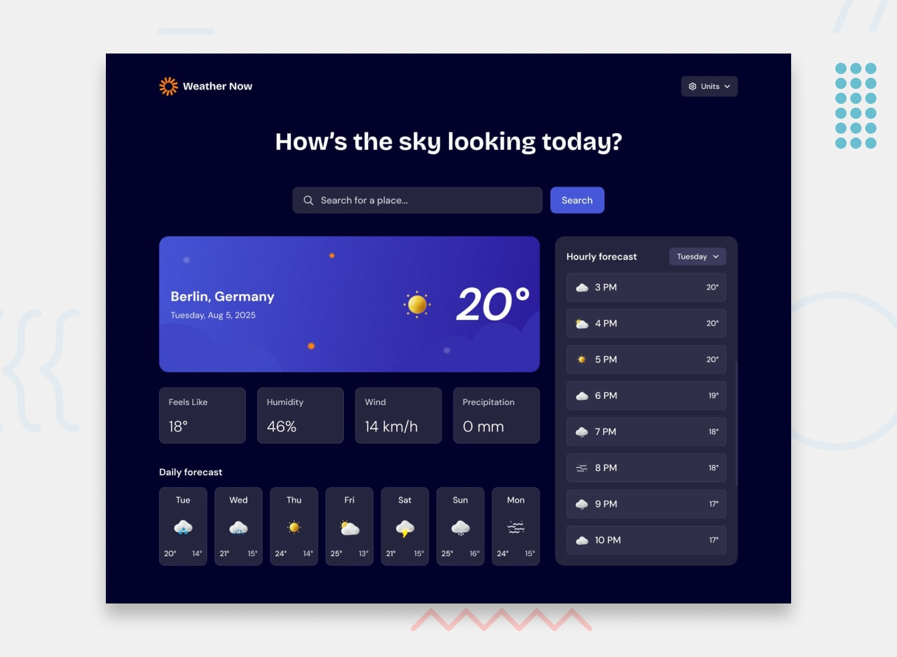

#  Weather Now

A clean, responsive weather app built with vanilla HTML, Tailwind CSS, and JavaScript.  
Search any city, switch units, and explore daily + hourly forecasts — all powered by the free Open-Meteo API.



---

###  Features

-  Search any location with live suggestions
-  Current weather with feels like, humidity, wind & precipitation
-  7-day daily forecast
-  Hourly forecast with day selector
-  Units toggle (Celsius/Fahrenheit, km/h/mph, mm/inches)
-  Fully responsive (mobile → desktop)
-  Fast & lightweight — no frameworks

---

###  Built With

- HTML5
- Tailwind CSS
- Vanilla JavaScript (async/await)
- [Open-Meteo API](https://open-meteo.com/) (free, no API key needed)

---

###  Getting Started

1. Clone the repo or download the files
2. Open `index.html` in your browser

That’s it. No build step required.

```bash
# Optional: run with a local server
npx serve .

 Design
This project is based on the Frontend Mentor - Weather App challenge.

 Credits

* Design: Frontend Mentor
* Weather data: Open-Meteo
* Fonts: DM Sans + Bricolage Grotesque
